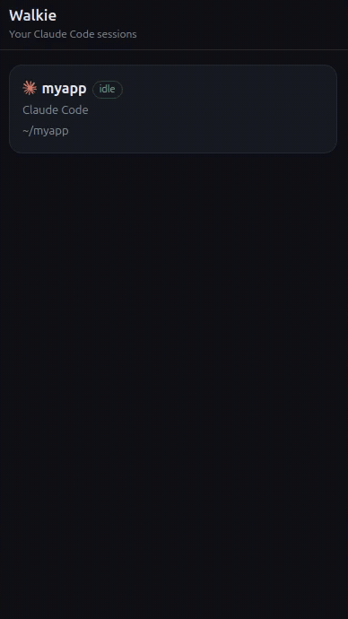

# Walkie

Talk to Claude Code from your phone: hold a button, say what you want, and hear the answer read back.

<p align="center"></p>

## Getting started

- **You need:**
  - A Mac (Apple silicon) or a Linux computer with Claude Code on it.
  - Tailscale on that computer and on your phone, signed in to the same account.
  - An xAI API key (console.x.ai, API Keys).
- **Install:** paste this into a terminal on that computer.

  ```
  curl -fsSL https://chippy.fly.dev/walkie | sh
  ```

Then:

1. Paste your xAI key when it asks. If Tailscale needs anything, it tells you what to do.
2. Sign in with GitHub or Google, or continue as a guest. It's only so your feedback shows your name.
3. Type `walkie` to start it. It stays open and shows what's happening; Ctrl-C stops it. On a server over SSH, use
   `walkie start -b` so it keeps running after you disconnect.
4. Start Claude Code in your project. If Claude Code was already open before you installed, type `/reload-plugins` in
   it.
5. On your phone, with Tailscale on, scan the QR code walkie shows, or open the link it printed.
6. Pick your session and hold to talk.

## Stop and remove

- `walkie stop` stops a background walkie.
- `walkie uninstall` removes all of it.

## Privacy

Walkie runs on your computer and reaches your phone only over your own Tailscale network. What you say and the replies
it reads aloud go to xAI with your own key. Feedback goes only when you send it. [PRIVACY.md](PRIVACY.md) has the
details.

## Links

- Walkie: https://chippy.fly.dev/walkie
- Privacy: [PRIVACY.md](PRIVACY.md)

## License

These docs are open source under the MIT license (see [LICENSE](LICENSE)). Walkie itself is not open source.
